# Database Schema (ERD)

Source of truth: `HRD_Intelligence_Data_Dictionary` (Word) and `HRD_Intelligence_ERD-Version_3` (draw.io image). Database: PostgreSQL (+ pgvector). All PKs are `uuid`, auto generated. Timestamps are `timestamptz`.

Conventions:
- **Req** = NOT NULL. `PK`, `FK`, `PK/FK` = key type. Nullable FKs say NULLABLE in the notes.
- Enum values are listed in the Notes column.
- Tables with `last_synced_at` hold data synced from external APIs (RDA API for attendance/extra-class/overtime sessions, Assessment API for students/scores/classes).

## Relationship diagram (Mermaid)

Relationships only (columns are in the per-table sections below). `||--o{` means one parent to many children. Lines whose FK has no `Reference` in the dictionary are omitted (see Open Questions in CLAUDE.md).

```mermaid
erDiagram
    roles ||--o{ users : "role_id"
    students |o--o{ users : "student_id"
    alumni |o--o{ users : "alumni_id"
    generations ||--o{ classrooms : "generation_id"
    courses |o--o{ classrooms : "course_id"
    generations ||--o{ students : "generation_id"
    classrooms |o--o{ students : "classroom_id"
    students ||--o{ student_courses : "student_id"
    courses ||--o{ student_courses : "course_id"
    users ||--o{ instructor_assignments : "instructor_id"
    courses ||--o{ instructor_assignments : "course_id"
    classrooms ||--o{ instructor_assignments : "classroom_id"
    students ||--o{ attendance : "student_id"
    classrooms ||--o{ attendance : "classroom_id"
    users |o--o{ attendance : "instructor_id"
    students ||--o{ attendance_permissions : "student_id"
    attendance |o--o{ attendance_permissions : "attendance_id"
    users |o--o{ attendance_permissions : "approved_by"
    students ||--o{ scores : "student_id"
    classrooms |o--o{ scores : "classroom_id"
    students ||--o{ monthly_scores : "student_id"
    courses |o--o{ monthly_scores : "course_id"
    users ||--o{ student_evaluation : "instructor_id"
    students ||--o{ student_evaluation : "student_id"
    classrooms |o--o{ student_evaluation : "classroom_id"
    courses |o--o{ student_evaluation : "course_id"
    students ||--o{ risk_alerts : "student_id"
    users |o--o{ risk_alerts : "resolved_by"
    users |o--o{ hourly_rates : "updated_by"
    students ||--o{ extra_class_records : "student_id"
    users ||--o{ extra_class_records : "instructor_id"
    users |o--o{ extra_class_records : "approved_by"
    attendance |o--o{ extra_class_records : "attendance_id"
    hourly_rates ||--o{ extra_class_records : "rate_id"
    users ||--o{ instructor_overtime : "instructor_id"
    users |o--o{ instructor_overtime : "reviewed_by"
    hourly_rates ||--o{ instructor_overtime : "rate_id"
    allowance_types ||--o{ instructor_overtime : "allowance_type_id"
    attendance |o--o{ instructor_overtime : "attendance_id"
    users |o--o{ allowance_rules : "updated_by"
    allowance_types ||--o{ allowance_rules : "allowance_type_id"
    users |o--o{ allowance_rule : "updated_by"
    allowance_types ||--o{ allowance_rule : "allowance_type_id"
    users |o--o{ calculation_type_rules : "updated_by"
    allowance_rule ||--o{ calculation_type_rules : "allowance_rule_id"
    students ||--o{ monthly_allowances : "student_id"
    classrooms |o--o{ monthly_allowances : "classroom_id"
    allowance_rule |o--o{ monthly_allowances : "allowance_rule_id"
    monthly_allowances ||--o{ monthly_allowance_items : "monthly_allowance_id"
    allowance_types ||--o{ monthly_allowance_items : "allowance_type_id"
    allowance_rules |o--o{ monthly_allowance_items : "allowance_rule_id"
    challenge_teams |o--o{ monthly_allowance_items : "challenge_team_id"
    courses ||--o{ coding_challenges : "course_id"
    generations ||--o{ coding_challenges : "generation_id"
    users |o--o{ coding_challenges : "created_by"
    coding_challenges ||--o{ challenge_prizes : "challenge_id"
    coding_challenges ||--o{ challenge_teams : "challenge_id"
    challenge_teams ||--o{ challenge_team_members : "team_id"
    students ||--o{ challenge_team_members : "student_id"
    generations ||--o{ alumni : "generation_id"
    users ||--o{ alumni : "created_by"
    students |o--o{ alumni : "student_id"
    alumni ||--o{ alumni_courses : "alumni_id"
    courses ||--o{ alumni_courses : "course_id"
    alumni ||--o{ employment_history : "alumni_id"
    organizations ||--o{ employment_history : "organization_id"
    alumni ||--o{ alumni_documents : "alumni_id"
    users |o--o{ alumni_documents : "uploaded_by"
    users |o--o{ profile_update_requests : "requested_by"
    alumni ||--o{ profile_update_requests : "alumni_id"
    agent_logs |o--o{ profile_update_requests : "agent_log_id"
    users |o--o{ profile_update_requests : "reviewed_by"
    folders |o--o{ folders : "parent_folder_id"
    users ||--o{ folders : "owner_id"
    folders |o--o{ files : "folder_id"
    users ||--o{ files : "owner_id"
    files |o--o{ permissions : "file_id"
    folders |o--o{ permissions : "folder_id"
    users ||--o{ permissions : "user_id"
    users ||--o{ permissions : "granted_by"
    users ||--o{ chat_sessions : "user_id"
    folders |o--o{ chat_sessions : "folder_id"
    chat_sessions ||--o{ chat_session_files : "session_id"
    files ||--o{ chat_session_files : "file_id"
    chat_sessions ||--o{ chat_messages : "session_id"
    files |o--o{ chat_messages : "file_id"
    files ||--o{ document_chunks : "file_id"
    document_chunks ||--o{ chunk_embeddings : "chunk_id"
    ai_agents ||--o{ agent_configurations : "agent_id"
    users |o--o{ agent_configurations : "updated_by"
    ai_agents ||--o{ agent_logs : "agent_id"
    users ||--o{ user_agent_settings : "user_id"
    ai_agents ||--o{ user_agent_settings : "agent_id"
    files |o--o{ ai_reports : "file_id"
    users |o--o{ ai_reports : "generated_by"
    agent_logs |o--o{ ai_reports : "agent_log_id"
    ai_reports ||--o{ report_student_summaries : "ai_report_id"
    students ||--o{ report_student_summaries : "student_id"
    users ||--o{ report_student_summaries : "instructor_id"
    agent_logs |o--o{ weekly_summaries : "agent_log_id"
    generations |o--o{ weekly_summaries : "generation_id"
    files |o--o{ weekly_summaries : "file_id"
    alumni |o--o{ draft_emails : "alumni_id"
    risk_alerts |o--o{ draft_emails : "risk_alert_id"
    users |o--o{ draft_emails : "created_by"
    agent_logs |o--o{ draft_emails : "agent_log_id"
    users |o--o{ draft_emails : "sent_by"
    chat_messages |o--o{ draft_emails : "chat_message_id"
    files |o--o{ draft_emails : "file_id"
    users ||--o{ notifications : "user_id"
    generations |o--o{ dashboard_snapshots : "generation_id"
```

## Tables

Index: `roles`, `users`, `generations`, `courses`, `classrooms`, `students`, `student_courses`, `instructor_assignments`, `attendance`, `attendance_permissions`, `scores`, `monthly_scores`, `student_evaluation`, `risk_alerts`, `hourly_rates`, `extra_class_records`, `instructor_overtime`, `allowance_types`, `allowance_rules`, `allowance_rule`, `calculation_type_rules`, `monthly_allowances`, `monthly_allowance_items`, `coding_challenges`, `challenge_prizes`, `challenge_teams`, `challenge_team_members`, `alumni`, `alumni_courses`, `organizations`, `employment_history`, `alumni_documents`, `profile_update_requests`, `folders`, `files`, `permissions`, `chat_sessions`, `chat_session_files`, `chat_messages`, `document_chunks`, `chunk_embeddings`, `ai_agents`, `agent_configurations`, `agent_logs`, `user_agent_settings`, `ai_reports`, `report_student_summaries`, `weekly_summaries`, `draft_emails`, `notifications`, `dashboard_snapshots`

### roles

| Field | Type | Req | Key | Default | References | Notes |
| --- | --- | --- | --- | --- | --- | --- |
| `role_id` | uuid | Y | PK |  |  | Auto generated |
| `role_name` | enum | Y |  |  |  | unique admin, instructor |
| `description` | varchar(50) |  |  |  |  |  |
| `is_lead` | boolean | Y |  | false |  | true = lead role |

### users

| Field | Type | Req | Key | Default | References | Notes |
| --- | --- | --- | --- | --- | --- | --- |
| `user_id` | uuid | Y | PK |  |  | Auto generated |
| `keycloak_id` | uuid | Y |  |  |  | unique Account ID in Keycloak (handles login and passwords) |
| `english_name` | varchar(100) | Y |  |  |  |  |
| `khmer_name` | varchar(100) |  |  |  |  |  |
| `email` | varchar(255) | Y |  |  |  | unique |
| `phone_number` | varchar(20) |  |  |  |  |  |
| `gender` | varchar(10) |  |  |  |  |  |
| `profile_image_url` | text |  |  |  |  |  |
| `is_active` | boolean | Y |  | true |  | true = active false = inactive |
| `created_at` | timestamptz | Y |  | current_timestamp |  |  |
| `updated_at` | timestamptz | Y |  | current_timestamp |  |  |
| `role_id` | uuid | Y | FK |  | roles |  |
| `student_id` | uuid |  | FK |  | students | NULLABLE Set when the user was a student (unique) |
| `alumni_id` | uuid |  | FK |  | alumni | NULLABLE Set when the user is also an alumnus (unique) |

### generations

| Field | Type | Req | Key | Default | References | Notes |
| --- | --- | --- | --- | --- | --- | --- |
| `generation_id` | uuid | Y | PK |  |  | Auto generated |
| `generation_number` | int | Y |  |  |  | unique e.g. 13 |
| `start_date` | date |  |  |  |  |  |
| `end_date` | date |  |  |  |  |  |
| `is_active` | boolean | Y |  | true |  | true = current generation |

### courses

| Field | Type | Req | Key | Default | References | Notes |
| --- | --- | --- | --- | --- | --- | --- |
| `course_id` | uuid | Y | PK |  |  | Auto generated |
| `course_name` | varchar(100) | Y |  |  |  | unique e.g. Mobile Development |
| `description` | text |  |  |  |  |  |
| `course_type` | enum | Y |  |  |  | it, korean |
| `course_stage_type` | enum | Y |  |  |  | basic, advanced |
| `start_date` | date |  |  |  |  |  |
| `end_date` | date |  |  |  |  |  |
| `is_main_subject` | boolean | Y |  | true |  | true = main subject false = sub subject |

### classrooms

| Field | Type | Req | Key | Default | References | Notes |
| --- | --- | --- | --- | --- | --- | --- |
| `classroom_id` | uuid | Y | PK |  |  | Auto generated |
| `classroom_name` | varchar(50) | Y |  |  |  | e.g. MB13 |
| `last_synced_at` | timestamptz |  |  |  |  | Last sync time from the external API |
| `generation_id` | uuid | Y | FK |  | generations |  |
| `course_id` | uuid |  | FK |  | courses | NULLABLE |

### students

| Field | Type | Req | Key | Default | References | Notes |
| --- | --- | --- | --- | --- | --- | --- |
| `student_id` | uuid | Y | PK |  |  | Auto generated |
| `external_id` | varchar(64) | Y |  |  |  | unique Student ID in the Assessment API |
| `english_name` | varchar(100) | Y |  |  |  |  |
| `khmer_name` | varchar(100) |  |  |  |  |  |
| `email` | varchar(255) | Y |  |  |  | unique |
| `phone_number` | varchar(20) |  |  |  |  |  |
| `gender` | enum |  |  |  |  | male, female |
| `dob` | date |  |  |  |  | Date of birth |
| `university` | varchar(150) |  |  |  |  |  |
| `enrollment_date` | date |  |  |  |  |  |
| `status` | enum | Y |  | active |  | active, dropped, graduated |
| `profile_image_url` | text |  |  |  |  |  |
| `last_synced_at` | timestamptz |  |  |  |  | Last sync time from the external API |
| `exit_reviewed` | boolean | Y |  | false |  | true = exit review done after dropping |
| `drop_reason` | text |  |  |  |  | Reason when status = dropped |
| `generation_id` | uuid | Y | FK |  | generations |  |
| `classroom_id` | uuid |  | FK |  | classrooms | NULLABLE |

### student_courses

| Field | Type | Req | Key | Default | References | Notes |
| --- | --- | --- | --- | --- | --- | --- |
| `student_id` | uuid | Y | PK/FK |  | students |  |
| `course_id` | uuid | Y | PK/FK |  | courses |  |
| `enrolled_at` | date |  |  |  |  |  |

### instructor_assignments

| Field | Type | Req | Key | Default | References | Notes |
| --- | --- | --- | --- | --- | --- | --- |
| `assignment_id` | uuid | Y | PK |  |  | Auto generated |
| `assigned_at` | timestamptz | Y |  | current_timestamp |  |  |
| `instructor_id` | uuid | Y | FK |  | users |  |
| `course_id` | uuid | Y | FK |  | courses |  |
| `classroom_id` | uuid | Y | FK |  | classrooms |  |

### attendance

| Field | Type | Req | Key | Default | References | Notes |
| --- | --- | --- | --- | --- | --- | --- |
| `attendance_id` | uuid | Y | PK |  |  | Auto generated |
| `rda_attendance_id` | varchar(50) | Y |  |  |  | unique Record ID in the RDA API |
| `attendance_date` | date | Y |  |  |  |  |
| `attendance_type` | enum | Y |  |  |  | morning, afternoon |
| `day_type` | enum | Y |  |  |  | weekday, weekend |
| `check_in_time` | time |  |  |  |  |  |
| `check_in_status` | enum |  |  |  |  | on_time, late, missed_scan |
| `check_out_time` | time |  |  |  |  |  |
| `check_out_status` | enum |  |  |  |  | on_time, early_leave, missed_scan |
| `attendance_status` | enum | Y |  |  |  | on_time, late, absent, permission |
| `last_synced_at` | timestamptz |  |  |  |  | Last sync time from the external API |
| `student_id` | uuid | Y | FK |  | students |  |
| `classroom_id` | uuid | Y | FK |  | classrooms |  |
| `instructor_id` | uuid |  | FK |  | users | NULLABLE Instructor of the session |

### attendance_permissions

| Field | Type | Req | Key | Default | References | Notes |
| --- | --- | --- | --- | --- | --- | --- |
| `permission_id` | uuid | Y | PK |  |  | Auto generated |
| `permission_type` | enum | Y |  |  |  | go_out, absent |
| `permission_date` | date | Y |  |  |  |  |
| `start_time` | time |  |  |  |  | For go-out permission |
| `end_time` | time |  |  |  |  | For go-out permission |
| `reason` | text |  |  |  |  |  |
| `status` | enum | Y |  | pending |  | pending, approved, rejected |
| `created_at` | timestamptz | Y |  | current_timestamp |  |  |
| `student_id` | uuid | Y | FK |  | students |  |
| `attendance_id` | uuid |  | FK |  | attendance | NULLABLE Attendance record it applies to |
| `approved_by` | uuid |  | FK |  | users | NULLABLE Admin who approved / rejected |

### scores

| Field | Type | Req | Key | Default | References | Notes |
| --- | --- | --- | --- | --- | --- | --- |
| `score_id` | uuid | Y | PK |  |  | Auto generated |
| `score_type` | enum | Y |  |  |  | assignment, quiz, exam, homework |
| `subject` | enum | Y |  |  |  | course, it, korean |
| `title` | varchar(150) |  |  |  |  | e.g. Quiz 3 – Spring Boot |
| `score` | decimal(5,2) | Y |  |  |  | Score obtained |
| `assessed_at` | date |  |  |  |  | Date of the assessment |
| `last_synced_at` | timestamptz |  |  |  |  | Last sync time from the external API |
| `pa_score` | decimal(5,2) |  |  |  |  | P.A. score |
| `max_score` | decimal(5,2) | Y |  |  |  | Maximum score of this assessment |
| `score_weight` | decimal(5,2) |  |  |  |  | Weight in % |
| `total_score` | decimal(5,2) |  |  |  |  | score × score_weight |
| `student_id` | uuid | Y | FK |  | students |  |
| `classroom_id` | uuid |  | FK |  | classrooms | NULLABLE |
| `course_id` | uuid |  | FK |  |  | NULLABLE |

### monthly_scores

| Field | Type | Req | Key | Default | References | Notes |
| --- | --- | --- | --- | --- | --- | --- |
| `monthly_score_id` | uuid | Y | PK |  |  | Auto generated |
| `subject` | enum | Y |  |  |  | it, korean |
| `score_month` | date | Y |  |  |  | First day of the month |
| `score` | decimal(5,2) | Y |  |  |  |  |
| `max_score` | decimal(5,2) | Y |  |  |  |  |
| `created_at` | timestamptz | Y |  | current_timestamp |  |  |
| `student_id` | uuid | Y | FK |  | students |  |
| `course_id` | uuid |  | FK |  | courses | NULLABLE |

### student_evaluation

| Field | Type | Req | Key | Default | References | Notes |
| --- | --- | --- | --- | --- | --- | --- |
| `student_evaluation_id` | uuid | Y | PK |  |  | Auto generated |
| `hard_skill_score` | smallint | Y |  |  |  | 1 – 5 |
| `soft_skill_score` | smallint | Y |  |  |  | 1 – 5 |
| `attitude_score` | smallint | Y |  |  |  | 1 – 5 |
| `overall_score` | decimal(3,2) |  |  |  |  | Average of the 3 scores |
| `content` | text |  |  |  |  | Instructor comment |
| `is_private` | boolean | Y |  | true |  | true = hidden from students |
| `max_score` | decimal(3,2) | Y |  | 5 |  |  |
| `created_at` | timestamptz | Y |  | current_timestamp |  |  |
| `updated_at` | timestamptz | Y |  | current_timestamp |  |  |
| `edited_at` | timestamptz |  |  |  |  | Last manual edit |
| `instructor_id` | uuid | Y | FK |  | users | Instructor who wrote it |
| `student_id` | uuid | Y | FK |  | students |  |
| `classroom_id` | uuid |  | FK |  | classrooms | NULLABLE |
| `course_id` | uuid |  | FK |  | courses | NULLABLE |

### risk_alerts

| Field | Type | Req | Key | Default | References | Notes |
| --- | --- | --- | --- | --- | --- | --- |
| `alert_id` | uuid | Y | PK |  |  | Auto generated |
| `risk_type` | enum | Y |  |  |  | academic, attendance, attitude |
| `risk_level` | enum | Y |  |  |  | low, medium, high |
| `reason` | text |  |  |  |  | AI explanation |
| `average_score` | decimal(5,2) |  |  |  |  | Average score when flagged |
| `attendance_rate` | decimal(5,2) |  |  |  |  | Attendance % when flagged |
| `attitude` | varchar(10) |  |  |  |  | Attitude level when flagged |
| `status` | enum | Y |  | open |  | open, resolved |
| `score_change` | decimal(5,2) |  |  |  |  | Score change vs previous period |
| `created_at` | timestamptz | Y |  | current_timestamp |  |  |
| `flagged_at` | timestamptz | Y |  | current_timestamp |  |  |
| `student_id` | uuid | Y | FK |  | students |  |
| `attendance_id` | uuid |  | FK |  |  | NULLABLE Attendance record that triggered it |
| `resolved_by` | uuid |  | FK |  | users | NULLABLE Admin who resolved it |

### hourly_rates

| Field | Type | Req | Key | Default | References | Notes |
| --- | --- | --- | --- | --- | --- | --- |
| `rate_id` | uuid | Y | PK |  |  | Auto generated |
| `rate_type` | enum | Y |  |  |  | unique student_extra_class, instructor_overtime |
| `amount_per_hour` | decimal(10,2) | Y |  |  |  | e.g. 1.00 (USD) |
| `created_at` | timestamptz | Y |  | current_timestamp |  |  |
| `updated_at` | timestamptz | Y |  | current_timestamp |  |  |
| `updated_by` | uuid |  | FK |  | users | NULLABLE |

### extra_class_records

| Field | Type | Req | Key | Default | References | Notes |
| --- | --- | --- | --- | --- | --- | --- |
| `record_id` | uuid | Y | PK |  |  | Auto generated |
| `rda_session_id` | varchar(50) |  |  |  |  | Session ID in the RDA API |
| `session_date` | date | Y |  |  |  |  |
| `subject` | varchar(100) |  |  |  |  |  |
| `hours` | decimal(4,2) | Y |  |  |  | Must be > 0 |
| `allowance_amount` | decimal(10,2) | Y |  |  |  | hours × hourly_rates.amount_per_hour, stored when approved |
| `status` | enum | Y |  | pending |  | pending, approved, rejected |
| `student_id` | uuid | Y | FK |  | students |  |
| `instructor_id` | uuid | Y | FK |  | users |  |
| `approved_by` | uuid |  | FK |  | users | NULLABLE |
| `attendance_id` | uuid |  | FK |  | attendance | NULLABLE |
| `rate_id` | uuid | Y | FK |  | hourly_rates | Rate used for the calculation |

### instructor_overtime

| Field | Type | Req | Key | Default | References | Notes |
| --- | --- | --- | --- | --- | --- | --- |
| `overtime_id` | uuid | Y | PK |  |  | Auto generated |
| `rda_session_id` | varchar(50) |  |  |  |  | Session ID in the RDA API |
| `overtime_date` | date | Y |  |  |  |  |
| `start_time` | time | Y |  |  |  |  |
| `end_time` | time | Y |  |  |  | Must be after start_time |
| `hours` | decimal(4,2) | Y |  |  |  |  |
| `overtime_type` | enum | Y |  |  |  | weekday, weekend |
| `description` | text |  |  |  |  |  |
| `status` | enum | Y |  | submitted |  | submitted, approved, rejected |
| `reject_reason` | text |  |  |  |  |  |
| `submitted_at` | timestamptz | Y |  | current_timestamp |  |  |
| `reviewed_at` | timestamptz |  |  |  |  |  |
| `ot_fee` | decimal(10,2) |  |  |  |  | hours × hourly_rates.amount_per_hour, stored when approved |
| `instructor_id` | uuid | Y | FK |  | users |  |
| `reviewed_by` | uuid |  | FK |  | users | NULLABLE |
| `rate_id` | uuid | Y | FK |  | hourly_rates | Rate used for the calculation |
| `allowance_type_id` | uuid | Y | FK |  | allowance_types | type_code = instructor_overtime |
| `attendance_id` | uuid |  | FK |  | attendance | NULLABLE |

### allowance_types

| Field | Type | Req | Key | Default | References | Notes |
| --- | --- | --- | --- | --- | --- | --- |
| `allowance_type_id` | uuid | Y | PK |  |  | Auto generated |
| `name` | varchar(50) | Y |  |  |  |  |
| `calculation_type` | enum | Y |  |  |  | fixed, score_tier, per_hour, role_based, attendance_tier |
| `description` | text |  |  |  |  |  |
| `is_active` | boolean | Y |  | true |  |  |
| `type_code` | enum | Y |  |  |  | unique meal, korean, it_score, extra_class, class_leader, attitude, instructor_overtime, other |

### allowance_rules

| Field | Type | Req | Key | Default | References | Notes |
| --- | --- | --- | --- | --- | --- | --- |
| `rule_id` | uuid | Y | PK |  |  | Auto generated |
| `min_value` | decimal(5,2) |  |  |  |  | Minimum score / attendance % for this tier |
| `amount` | decimal(10,2) | Y |  |  |  |  |
| `updated_by` | uuid |  | FK |  | users | NULLABLE |
| `allowance_type_id` | uuid | Y | FK |  | allowance_types |  |

### allowance_rule

| Field | Type | Req | Key | Default | References | Notes |
| --- | --- | --- | --- | --- | --- | --- |
| `allowance_rule_id` | uuid | Y | PK |  |  | Auto generated |
| `title` | varchar(100) | Y |  |  |  |  |
| `description` | varchar(100) |  |  |  |  |  |
| `calculation_type` | varchar(100) | Y |  |  |  |  |
| `updated_by` | uuid |  | FK |  | users | NULLABLE |
| `allowance_type_id` | uuid | Y | FK |  | allowance_types |  |

### calculation_type_rules

| Field | Type | Req | Key | Default | References | Notes |
| --- | --- | --- | --- | --- | --- | --- |
| `rule_id` | uuid | Y | PK |  |  | Auto generated |
| `min_value` | decimal(5,2) |  |  |  |  |  |
| `amount` | decimal(10,2) | Y |  |  |  |  |
| `unit` | varchar(20) |  |  |  |  | e.g. per_hour, per_month |
| `description` | varchar(100) |  |  |  |  |  |
| `updated_by` | uuid |  | FK |  | users | NULLABLE |
| `allowance_rule_id` | uuid | Y | FK |  | allowance_rule |  |

### monthly_allowances

| Field | Type | Req | Key | Default | References | Notes |
| --- | --- | --- | --- | --- | --- | --- |
| `monthly_allowance_id` | uuid | Y | PK |  |  | Auto generated |
| `allowance_month` | date | Y |  |  |  | First day of the month |
| `total_amount` | decimal(10,2) | Y |  |  |  | Sum of the items |
| `payment_status` | enum | Y |  | pending |  | pending, paid |
| `paid_at` | timestamptz |  |  |  |  |  |
| `student_id` | uuid | Y | FK |  | students |  |
| `classroom_id` | uuid |  | FK |  | classrooms | NULLABLE |
| `allowance_rule_id` | uuid |  | FK |  | allowance_rule | NULLABLE |

### monthly_allowance_items

| Field | Type | Req | Key | Default | References | Notes |
| --- | --- | --- | --- | --- | --- | --- |
| `item_id` | uuid | Y | PK |  |  | Auto generated |
| `amount` | decimal(10,2) | Y |  |  |  |  |
| `monthly_allowance_id` | uuid | Y | FK |  | monthly_allowances |  |
| `allowance_type_id` | uuid | Y | FK |  | allowance_types |  |
| `allowance_rule_id` | uuid |  | FK |  | allowance_rules | NULLABLE Rule tier applied |
| `challenge_team_id` | uuid |  | FK |  | challenge_teams | NULLABLE Set for coding challenge prizes |

### coding_challenges

| Field | Type | Req | Key | Default | References | Notes |
| --- | --- | --- | --- | --- | --- | --- |
| `challenge_id` | uuid | Y | PK |  |  | Auto generated |
| `title` | varchar(150) | Y |  |  |  |  |
| `description` | text |  |  |  |  |  |
| `challenge_date` | date | Y |  |  |  |  |
| `payout_month` | date |  |  |  |  | Month the prize is paid in |
| `max_team_size` | int |  |  |  |  |  |
| `prize_distribution` | enum | Y |  | split_equally |  | split_equally |
| `is_included_in_allowance` | boolean | Y |  | true |  | true = prize added to monthly allowance |
| `frequency` | enum | Y |  | one_off |  | one_off |
| `status` | enum | Y |  | draft |  | draft, active, completed |
| `created_at` | timestamptz | Y |  | current_timestamp |  |  |
| `course_id` | uuid | Y | FK |  | courses |  |
| `generation_id` | uuid | Y | FK |  | generations |  |
| `created_by` | uuid |  | FK |  | users | NULLABLE |

### challenge_prizes

| Field | Type | Req | Key | Default | References | Notes |
| --- | --- | --- | --- | --- | --- | --- |
| `prize_id` | uuid | Y | PK |  |  | Auto generated |
| `placing` | int | Y |  |  |  | 1 = first place |
| `amount` | decimal(10,2) | Y |  |  |  |  |
| `challenge_id` | uuid | Y | FK |  | coding_challenges |  |

### challenge_teams

| Field | Type | Req | Key | Default | References | Notes |
| --- | --- | --- | --- | --- | --- | --- |
| `team_id` | uuid | Y | PK |  |  | Auto generated |
| `team_name` | varchar(100) | Y |  |  |  |  |
| `placing` | int |  |  |  |  | Final placing |
| `created_at` | timestamptz | Y |  | current_timestamp |  |  |
| `challenge_id` | uuid | Y | FK |  | coding_challenges |  |

### challenge_team_members

| Field | Type | Req | Key | Default | References | Notes |
| --- | --- | --- | --- | --- | --- | --- |
| `team_id` | uuid | Y | PK/FK |  | challenge_teams |  |
| `student_id` | uuid | Y | PK/FK |  | students |  |

### alumni

| Field | Type | Req | Key | Default | References | Notes |
| --- | --- | --- | --- | --- | --- | --- |
| `alumni_id` | uuid | Y | PK |  |  | Auto generated |
| `english_name` | varchar(100) | Y |  |  |  |  |
| `khmer_name` | varchar(100) |  |  |  |  |  |
| `gender` | enum |  |  |  |  | male, female |
| `dob` | date |  |  |  |  | Date of birth |
| `personal_email` | varchar(255) |  |  |  |  |  |
| `phone_number` | varchar(20) |  |  |  |  |  |
| `education` | varchar(100) |  |  |  |  | Highest education |
| `employment_status` | enum | Y |  | unemployed |  | employed, freelance, further_studies, unemployed |
| `job_position` | varchar(30) |  |  |  |  | Current job title |
| `org_name` | varchar(30) |  |  |  |  | Current organization |
| `profile_image_url` | varchar(300) |  |  |  |  |  |
| `salary_range` | enum |  |  |  |  |  |
| `updated_at` | timestamptz | Y |  | current_timestamp |  |  |
| `sector` | enum |  |  |  |  | Current work sector local_sw_developer, international_sw, bank, government_official, scholarship_abroad, it_instructor, other |
| `is_employed` | boolean | Y |  | false |  |  |
| `is_update_requested` | boolean | Y |  | false |  | true = a profile update request is open |
| `generation_id` | uuid | Y | FK |  | generations |  |
| `created_by` | uuid | Y | FK |  | users | Admin who created the record |
| `student_id` | uuid |  | FK |  | students | NULLABLE Student record before graduating (unique) |

### alumni_courses

| Field | Type | Req | Key | Default | References | Notes |
| --- | --- | --- | --- | --- | --- | --- |
| `alumni_id` | uuid | Y | PK/FK |  | alumni |  |
| `course_id` | uuid | Y | PK/FK |  | courses |  |
| `completed_at` | date |  |  |  |  |  |

### organizations

| Field | Type | Req | Key | Default | References | Notes |
| --- | --- | --- | --- | --- | --- | --- |
| `organization_id` | uuid | Y | PK |  |  | Auto generated |
| `name` | varchar(150) | Y |  |  |  | unique |
| `sector` | enum |  |  |  |  | local_sw_developer, international_sw, bank, government_official, scholarship_abroad, it_instructor, other |
| `location` | varchar(150) |  |  |  |  |  |
| `created_at` | timestamptz | Y |  | current_timestamp |  |  |

### employment_history

| Field | Type | Req | Key | Default | References | Notes |
| --- | --- | --- | --- | --- | --- | --- |
| `employment_id` | uuid | Y | PK |  |  | Auto generated |
| `job_name` | varchar(100) | Y |  |  |  |  |
| `job_sector` | enum |  |  |  |  | local_sw_developer, international_sw, bank, government_official, scholarship_abroad, it_instructor, other |
| `start_date` | date | Y |  |  |  | Since when |
| `end_date` | date |  |  |  |  |  |
| `is_current` | boolean | Y |  | false |  | true = current job |
| `alumni_id` | uuid | Y | FK |  | alumni |  |
| `organization_id` | uuid | Y | FK |  | organizations |  |

### alumni_documents

| Field | Type | Req | Key | Default | References | Notes |
| --- | --- | --- | --- | --- | --- | --- |
| `document_id` | uuid | Y | PK |  |  | Auto generated |
| `document_type` | enum | Y |  |  |  | cv, certificate, other |
| `file_name` | varchar(255) | Y |  |  |  |  |
| `file_url` | text | Y |  |  |  |  |
| `uploaded_at` | timestamptz | Y |  | current_timestamp |  |  |
| `alumni_id` | uuid | Y | FK |  | alumni |  |
| `uploaded_by` | uuid |  | FK |  | users | NULLABLE Admin who uploaded it |

### profile_update_requests

| Field | Type | Req | Key | Default | References | Notes |
| --- | --- | --- | --- | --- | --- | --- |
| `request_id` | uuid | Y | PK |  |  | Auto generated |
| `trigger_type` | enum | Y |  | manual |  | manual, ai_scheduled |
| `token_hash` | varchar(255) | Y |  |  |  | Hash of the link token sent by email |
| `status` | enum | Y |  | sent |  | sent, submitted, reviewed, expired |
| `sent_at` | timestamptz | Y |  | current_timestamp |  |  |
| `expires_at` | timestamptz | Y |  |  |  | Link expiry |
| `submitted_at` | timestamptz |  |  |  |  |  |
| `reviewed_at` | timestamptz |  |  |  |  |  |
| `requested_by` | uuid |  | FK |  | users | NULLABLE Admin, NULL when sent by the agent |
| `alumni_id` | uuid | Y | FK |  | alumni |  |
| `agent_log_id` | uuid |  | FK |  | agent_logs | NULLABLE Agent run that sent it |
| `reviewed_by` | uuid |  | FK |  | users | NULLABLE |

### folders

| Field | Type | Req | Key | Default | References | Notes |
| --- | --- | --- | --- | --- | --- | --- |
| `folder_id` | uuid | Y | PK |  |  | Auto generated |
| `name` | varchar(255) | Y |  |  |  |  |
| `created_at` | timestamptz | Y |  | current_timestamp |  |  |
| `updated_at` | timestamptz | Y |  | current_timestamp |  |  |
| `deleted_at` | timestamptz |  |  |  |  | Soft delete; NULL = not deleted |
| `parent_folder_id` | uuid |  | FK |  | folders | NULLABLE NULL = root folder |
| `owner_id` | uuid | Y | FK |  | users |  |

### files

| Field | Type | Req | Key | Default | References | Notes |
| --- | --- | --- | --- | --- | --- | --- |
| `file_id` | uuid | Y | PK |  |  | Auto generated |
| `file_name` | varchar(255) | Y |  |  |  |  |
| `extension` | enum | Y |  |  |  | txt, md, xlsx, csv, pdf, docx, pptx, png, jpeg |
| `size_bytes` | bigint | Y |  |  |  | File size in bytes |
| `storage_url` | text | Y |  |  |  | Path in object storage |
| `processing_status` | enum | Y |  | pending |  | Status of text extraction / chunking pending, processing, completed, failed |
| `processed_at` | timestamptz |  |  |  |  | Time processing finished |
| `processing_error` | text |  |  |  |  | Error message if processing failed |
| `uploaded_at` | timestamptz | Y |  | current_timestamp |  |  |
| `updated_at` | timestamptz | Y |  | current_timestamp |  |  |
| `deleted_at` | timestamptz |  |  |  |  | Soft delete; NULL = not deleted |
| `folder_id` | uuid |  | FK |  | folders | NULLABLE NULL = not in a folder |
| `owner_id` | uuid | Y | FK |  | users |  |

### permissions

| Field | Type | Req | Key | Default | References | Notes |
| --- | --- | --- | --- | --- | --- | --- |
| `permission_id` | uuid | Y | PK |  |  | Auto generated |
| `permission` | enum | Y |  | viewer |  | viewer, editor |
| `granted_at` | timestamptz | Y |  | current_timestamp |  |  |
| `file_id` | uuid |  | FK |  | files | NULLABLE Either file_id or folder_id is set |
| `folder_id` | uuid |  | FK |  | folders | NULLABLE Either file_id or folder_id is set |
| `user_id` | uuid | Y | FK |  | users | User the access is given to |
| `granted_by` | uuid | Y | FK |  | users | User who shared it |

### chat_sessions

| Field | Type | Req | Key | Default | References | Notes |
| --- | --- | --- | --- | --- | --- | --- |
| `session_id` | uuid | Y | PK |  |  | Auto generated |
| `title` | varchar(150) | Y |  |  |  |  |
| `chat_type` | enum | Y |  | general |  | general, folder |
| `created_at` | timestamptz | Y |  | current_timestamp |  |  |
| `updated_at` | timestamptz | Y |  | current_timestamp |  |  |
| `user_id` | uuid | Y | FK |  | users |  |
| `folder_id` | uuid |  | FK |  | folders | NULLABLE Set when chat_type = folder |

### chat_session_files

| Field | Type | Req | Key | Default | References | Notes |
| --- | --- | --- | --- | --- | --- | --- |
| `session_id` | uuid | Y | PK/FK |  | chat_sessions |  |
| `file_id` | uuid | Y | PK/FK |  | files |  |

### chat_messages

| Field | Type | Req | Key | Default | References | Notes |
| --- | --- | --- | --- | --- | --- | --- |
| `message_id` | uuid | Y | PK |  |  | Auto generated |
| `sender` | enum | Y |  |  |  | user, ai |
| `message_type` | enum | Y |  | text |  | text, chart, table, file |
| `content` | text | Y |  |  |  | Message text |
| `visualization` | jsonb |  |  |  |  | Chart / table data when message_type = chart or table |
| `input_type` | enum | Y |  | text |  | text, voice |
| `created_at` | timestamptz | Y |  | current_timestamp |  |  |
| `source` | jsonb |  |  |  |  | Chunks / files the AI answer was based on |
| `session_id` | uuid | Y | FK |  | chat_sessions |  |
| `file_id` | uuid |  | FK |  | files | NULLABLE File attached to the message |

### document_chunks

| Field | Type | Req | Key | Default | References | Notes |
| --- | --- | --- | --- | --- | --- | --- |
| `chunk_id` | uuid | Y | PK |  |  | Auto generated |
| `chunk_index` | int | Y |  |  |  | Order of the chunk in the file |
| `content` | text | Y |  |  |  | Chunk text |
| `content_type` | enum | Y |  | text |  | text, title, table, image_text |
| `page_number` | int |  |  |  |  |  |
| `section_title` | varchar(255) |  |  |  |  |  |
| `token_count` | int |  |  |  |  |  |
| `extraction_method` | enum | Y |  | text |  | text, ocr_paddle, ocr_tesseract |
| `ocr_confidence` | decimal(5,2) |  |  |  |  | 0 – 100, only for OCR |
| `metadata` | jsonb |  |  |  |  |  |
| `created_at` | timestamptz | Y |  | current_timestamp |  |  |
| `file_id` | uuid | Y | FK |  | files |  |

### chunk_embeddings

| Field | Type | Req | Key | Default | References | Notes |
| --- | --- | --- | --- | --- | --- | --- |
| `embedding_id` | uuid | Y | PK |  |  | Auto generated |
| `embedding` | vector(1024) | Y |  |  |  | pgvector, 1024 dims (BAAI/bge-m3) |
| `model_name` | varchar(50) | Y |  | bge-m3 |  |  |
| `created_at` | timestamptz | Y |  | current_timestamp |  |  |
| `chunk_id` | uuid | Y | FK |  | document_chunks |  |

### ai_agents

| Field | Type | Req | Key | Default | References | Notes |
| --- | --- | --- | --- | --- | --- | --- |
| `agent_id` | uuid | Y | PK |  |  | Auto generated |
| `agent_code` | enum | Y |  |  |  | unique weekly_summary, feedback_summary, alumni_profile, at_risk, alumni_job_alert |
| `name` | varchar(100) | Y |  |  |  |  |
| `description` | text |  |  |  |  |  |
| `next_run_at` | timestamptz |  |  |  |  |  |
| `last_run_at` | timestamptz |  |  |  |  |  |

### agent_configurations

| Field | Type | Req | Key | Default | References | Notes |
| --- | --- | --- | --- | --- | --- | --- |
| `config_id` | uuid | Y | PK |  |  | Auto generated |
| `agent_type` | enum | Y |  |  |  | scheduled, trigger |
| `status` | enum | Y |  | active |  | active, paused |
| `cron_expression` | varchar(50) |  |  |  |  | Schedule, when agent_type = scheduled |
| `trigger_event` | varchar(50) |  |  |  |  | Event, when agent_type = trigger |
| `recipients` | enum |  |  |  |  | all_admins, hrd_admin, all_alumni |
| `output_description` | varchar(150) |  |  |  |  |  |
| `updated_at` | timestamptz | Y |  | current_timestamp |  |  |
| `agent_id` | uuid | Y | FK |  | ai_agents | unique One configuration per agent |
| `updated_by` | uuid |  | FK |  | users | NULLABLE |

### agent_logs

| Field | Type | Req | Key | Default | References | Notes |
| --- | --- | --- | --- | --- | --- | --- |
| `log_id` | uuid | Y | PK |  |  | Auto generated |
| `status` | enum | Y |  | running |  | running, succeeded, failed |
| `triggered_by` | enum | Y |  |  |  | schedule, event, manual |
| `triggered_at` | timestamptz | Y |  | current_timestamp |  |  |
| `finished_at` | timestamptz |  |  |  |  |  |
| `error_message` | text |  |  |  |  |  |
| `result` | varchar(255) |  |  |  |  | Short result text |
| `retry_count` | int | Y |  | 0 |  |  |
| `agent_id` | uuid | Y | FK |  | ai_agents |  |

### user_agent_settings

| Field | Type | Req | Key | Default | References | Notes |
| --- | --- | --- | --- | --- | --- | --- |
| `user_id` | uuid | Y | PK/FK |  | users |  |
| `agent_id` | uuid | Y | PK/FK |  | ai_agents |  |
| `is_enabled` | boolean | Y |  | true |  | true = user receives this agent's output |
| `updated_at` | timestamptz | Y |  | current_timestamp |  |  |

### ai_reports

| Field | Type | Req | Key | Default | References | Notes |
| --- | --- | --- | --- | --- | --- | --- |
| `ai_report_id` | uuid | Y | PK |  |  | Auto generated |
| `title` | varchar(200) | Y |  |  |  |  |
| `report_type` | enum | Y |  |  |  | feedback_summary, custom |
| `source` | enum | Y |  |  |  | agent, chat, manual |
| `period_start` | date |  |  |  |  |  |
| `period_end` | date |  |  |  |  |  |
| `summary` | text |  |  |  |  |  |
| `content` | jsonb |  |  |  |  | Report sections |
| `status` | enum | Y |  | generating |  | generating, completed, failed |
| `created_at` | timestamptz | Y |  | current_timestamp |  |  |
| `file_id` | uuid |  | FK |  | files | NULLABLE Exported file |
| `generated_by` | uuid |  | FK |  | users | NULLABLE Admin, NULL when agent |
| `agent_log_id` | uuid |  | FK |  | agent_logs | NULLABLE |

### report_student_summaries

| Field | Type | Req | Key | Default | References | Notes |
| --- | --- | --- | --- | --- | --- | --- |
| `item_id` | uuid | Y | PK |  |  | Auto generated |
| `note_count` | int | Y |  | 0 |  | Number of evaluations summarised |
| `trend` | enum | Y |  |  |  | improving, stable, declining, needs_support |
| `summary` | text | Y |  |  |  |  |
| `ai_report_id` | uuid | Y | FK |  | ai_reports |  |
| `student_id` | uuid | Y | FK |  | students |  |
| `instructor_id` | uuid | Y | FK |  | users |  |

### weekly_summaries

| Field | Type | Req | Key | Default | References | Notes |
| --- | --- | --- | --- | --- | --- | --- |
| `weekly_summary_id` | uuid | Y | PK |  |  | Auto generated |
| `week_start` | date | Y |  |  |  |  |
| `week_end` | date | Y |  |  |  |  |
| `summary_content` | text | Y |  |  |  |  |
| `status` | enum | Y |  | generated |  | generated, sent, failed |
| `generated_at` | timestamptz | Y |  | current_timestamp |  |  |
| `sent_at` | timestamptz |  |  |  |  |  |
| `metrics` | jsonb |  |  |  |  | KPI numbers of the week |
| `sources` | jsonb |  |  |  |  | Data sources used |
| `agent_log_id` | uuid |  | FK |  | agent_logs | NULLABLE |
| `generation_id` | uuid |  | FK |  | generations | NULLABLE |
| `file_id` | uuid |  | FK |  | files | NULLABLE Exported file |

### draft_emails

| Field | Type | Req | Key | Default | References | Notes |
| --- | --- | --- | --- | --- | --- | --- |
| `draft_email_id` | uuid | Y | PK |  |  | Auto generated |
| `email_type` | enum | Y |  |  |  | at_risk_warning, check_in, profile_update, other |
| `recipient_type` | enum | Y |  |  |  | student, alumni, admin |
| `recipient_email` | varchar(255) | Y |  |  |  |  |
| `subject` | varchar(255) | Y |  |  |  |  |
| `body` | text | Y |  |  |  |  |
| `status` | enum | Y |  | draft |  | draft, sent, failed |
| `fail_reason` | text |  |  |  |  |  |
| `created_at` | timestamptz | Y |  | current_timestamp |  |  |
| `sent_at` | timestamptz |  |  |  |  |  |
| `updated_at` | timestamptz | Y |  | current_timestamp |  |  |
| `alumni_id` | uuid |  | FK |  | alumni | NULLABLE |
| `risk_alert_id` | uuid |  | FK |  | risk_alerts | NULLABLE |
| `created_by` | uuid |  | FK |  | users | NULLABLE Admin, NULL when drafted by an agent |
| `agent_log_id` | uuid |  | FK |  | agent_logs | NULLABLE |
| `student_id` | uuid |  | FK |  |  | NULLABLE |
| `sent_by` | uuid |  | FK |  | users | NULLABLE |
| `chat_message_id` | uuid |  | FK |  | chat_messages | NULLABLE Drafted from AI chat |
| `file_id` | uuid |  | FK |  | files | NULLABLE Attachment |

### notifications

| Field | Type | Req | Key | Default | References | Notes |
| --- | --- | --- | --- | --- | --- | --- |
| `notification_id` | uuid | Y | PK |  |  | Auto generated |
| `notification_type` | enum | Y |  |  |  | low_attendance, declining_academic, alumni_update, overtime_reminder |
| `title` | varchar(150) | Y |  |  |  |  |
| `message` | text | Y |  |  |  |  |
| `channel` | enum | Y |  | in_app |  | in_app, email |
| `reference_type` | enum |  |  |  |  | Type of the record the notification points to risk_alert, alumni, profile_update_request, instructor_overtime, ai_report, weekly_summary |
| `reference_id` | uuid |  |  |  |  | ID of the record the notification points to |
| `is_read` | boolean | Y |  | false |  | true = read false = unread |
| `created_at` | timestamptz | Y |  | current_timestamp |  |  |
| `user_id` | uuid | Y | FK |  | users | Receiver of the notification |

### dashboard_snapshots

| Field | Type | Req | Key | Default | References | Notes |
| --- | --- | --- | --- | --- | --- | --- |
| `snapshot_id` | uuid | Y | PK |  |  | Auto generated |
| `snapshot_date` | date | Y |  |  |  |  |
| `metrics` | jsonb | Y |  |  |  | KPI card values |
| `created_at` | timestamptz | Y |  | current_timestamp |  |  |
| `generation_id` | uuid |  | FK |  | generations | NULLABLE |
